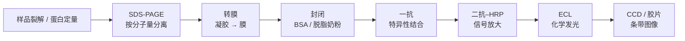

> [!abstract] 一句话
> Western blot 先用 **SDS-PAGE 按分子量**把蛋白质分开，再用**抗体按抗原表位**把目标蛋白认出来，最后用 **HRP 催化的化学发光**把“认出来”这件事放大成可成像的光信号。


*图 A–F 对应下文六个步骤；条带位置为示意，不是实验数据。*

> [!info] 读图顺序
> 上排 A → B → C，下排 D → E → F；箭头表示流程方向。

## 1. 核心逻辑：分离 → 识别 → 放大 → 读出



Western blot 的特异性来自**抗体**，分辨能力来自**电泳**，灵敏度来自**酶促放大**。三者缺一不可：

1. **分离**：SDS 使蛋白质变性并带上均匀的负电荷，迁移速度主要由分子量决定。
2. **识别**：一抗结合目标蛋白的特定表位；二抗结合一抗的 Fc 段，并携带 HRP。
3. **放大**：一个一抗可被多个二抗结合，每个 HRP 又能催化大量底物，弱信号被放大。
4. **读出**：ECL 产生的光被 CCD 或胶片记录；在未饱和范围内，条带强度与目标蛋白量相关。

## 2. 六个步骤

### A. 变性并带上负电荷

- **裂解**：RIPA、NP-40 或 SDS 裂解液，加蛋白酶抑制剂和磷酸酶抑制剂，全程冰上操作。
- **定量**：BCA 和 Bradford 是实验室里最常用的两种"测蛋白浓度"的方法。核心思路都一样：**让蛋白质和某种试剂发生反应，产生颜色变化，颜色越深说明蛋白越多，再用仪器（分光光度计）读颜色深浅，就能算出浓度。**

两种方法的区别在于"怎么变色"：
'''
**1. BCA 法**
- **原理**：蛋白质在碱性环境里能把铜离子（Cu²⁺）还原成亚铜离子（Cu⁺），然后 BCA 试剂再和 Cu⁺ 结合，形成紫色的复合物。
- **通俗理解**：蛋白先把铜"还原"，BCA 再"抓住"被还原的铜显紫色。颜色深浅≈蛋白量。
- **特点**：灵敏度较高，对去污剂（如 SDS）比较耐受；但容易受还原剂（如 DTT、巯基乙醇）和某些糖类干扰。

**2. Bradford 法**
- **原理**：考马斯亮蓝染料在酸性条件下原本是红棕色，一旦和蛋白质结合就变成蓝色。
- **通俗理解**：染料"粘"到蛋白上就变蓝，蛋白越多蓝色越深。
- **特点**：操作快、试剂稳定；但不同蛋白（尤其碱性蛋白、小分子肽）显色差异较大，且容易被去污剂干扰。

**一句话总结**：
两者都是"蛋白越多→颜色越深→测吸光度→换算浓度"。BCA 靠"还原铜再显紫"，Bradford 靠"染料结合变蓝"。选哪种要看你的样品里有没有会干扰的试剂，以及蛋白类型。；每泳道上样量保持一致（常见 20–30 µg）。
'''
- **变性**：加入 SDS 和 DTT（或 β-巯基乙醇），95 °C 加热 5–10 min。
- **原理**：SDS 以约 1.4 g/g 的比例结合蛋白质，覆盖上大量负电荷；DTT 还原二硫键，使蛋白质展开成线性多肽。
- **结果**：不同蛋白质的“电荷/质量比”趋于一致，SDS-PAGE 中的迁移率主要反映**分子量**，而不是天然电荷。

> [!warning] 注意
> - 膜蛋白、强疏水蛋白或大分子复合物可能在高热下聚集，可适当降低温度或缩短时间。
> - 有些抗体只识别**构象表位**，变性后会失效；这类目标需要考虑 native PAGE 或 IP。
> - 裂解液黏度过高（DNA/RNA 释放）会拖尾，可超声或加 Benzonase。

### B. SDS-PAGE 按分子量分离

- **浓缩胶**（stacking gel，pH 6.8）先把样品压成一条窄带；**分离胶**（resolving gel，pH 8.8）再按大小分开。
- SDS 包裹的蛋白质带负电，在电场中向**阳极（+）**迁移；小蛋白跑得快，大蛋白留在上方。
- 分子量标准（ladder）用于判断目标条带位置；翻译后修饰、剪接变体、强电荷异常都可能让表观分子量偏移。

| 丙烯酰胺浓度 | 大致分离范围（还原态） | 适用 |
|---|---|---|
| 6% | 50–200 kDa | 大蛋白 |
| 8% | 30–120 kDa | 中等偏大 |
| 10% | 20–80 kDa | 通用 |
| 12% | 10–60 kDa | 中小蛋白 |
| 15% | < 30 kDa | 小蛋白 / 多肽 |

> [!tip] 上样
> 上样过多会导致条带变宽、拖尾、“笑脸”或相邻泳道串样；上样过少则弱信号丢失。先做梯度上样，找线性范围。

### C. 转膜：把凝胶里的蛋白搬到膜上

蛋白质从凝胶转移到膜上，靠的还是电泳——所以**方向不能反**：

```text
阴极 (−)
  sponge
  filter paper
  gel
  membrane      ← 蛋白质从这里被“接住”
  filter paper
  sponge
阳极 (+)
```

- **膜的选择**：
  - **PVDF**：结合能力强，适合低丰度蛋白和重新孵育；使用前需甲醇活化 15–30 s，且绝不能干。
  - **NC（硝酸纤维素）**：无需活化、背景较低，但较脆，适合常规检测。
  - **尼龙膜**：结合强，但背景通常更高。
- **湿转**：常见 100 V、60–120 min，冰浴或 4 °C；也可 30 V 过夜。
- **半干转**：电压较低、时间较短，适合小蛋白，但要注意缓冲液量和发热。
- **验证转膜**：丽春红（Ponceau S）可逆染色，确认条带是否完整转移；也可用总蛋白染色或观察预染 ladder。
- **大小蛋白的取舍**：小蛋白容易“穿透”膜，可缩短时间或改用小孔径膜；大蛋白需要更长时间、更低电压，转膜液可加少量 SDS。

> [!warning] 常见事故
> 把膜放错一侧、膜变干、夹层有气泡、转膜液甲醇浓度过高导致凝胶收缩——都会造成“无条带”或“条带缺失”。

### D. 封闭非特异结合位点

- 转膜后，膜上仍有大量蛋白质结合位点；不封闭，抗体就会非特异吸附，产生高背景。
- 常用 **5% 脱脂奶粉**或 **5% BSA** 溶于 TBST，室温 1 h，或 4 °C 过夜。
- **磷酸化抗体优先用 BSA**：脱脂奶粉中的酪蛋白本身是磷酸蛋白，可能带来背景或竞争。
- 封闭不足 → 背景高；封闭过度 → 少数抗体信号变弱。背景高时可比较 BSA、奶粉、山羊血清等不同封闭液。

> [!tip] 不要把膜晾干
> 膜一旦干燥，蛋白质不可逆吸附，背景会明显升高；操作中始终保持湿润。

### E. 一抗与酶标二抗

- **一抗**：按说明书稀释（常见 1:1000），4 °C 过夜或室温 1–2 h；结合目标蛋白的特定表位。
- **洗膜**：TBST 洗 3 × 5–10 min，去除未结合的一抗。
- **二抗**：抗物种 IgG 偶联 HRP，识别一抗的 Fc 段；常见 1:5000–1:10000，室温 1 h。
- **洗膜**：再次 TBST 洗 3 × 5–10 min，去除未结合的二抗。
- **为什么要二抗**：二抗可结合多个一抗，且一个二抗可携带多个 HRP，实现信号放大；同时把“识别”转换成“酶活性”。

> [!warning] HRP 的抑制剂
> 叠氮钠（NaN₃）会抑制 HRP，含 NaN₃ 的缓冲液不要用于二抗稀释或 ECL 前的最后洗涤。

### F. ECL 化学发光显影

HRP 在 H₂O₂ 存在下氧化鲁米诺（luminol），生成激发态的 3-氨基邻苯二甲酸，回到基态时发出约 **425 nm** 的光：

```text
HRP + H₂O₂ + luminol  →  3-aminophthalate* + N₂ + light (≈425 nm)
```

- 将 ECL 底物均匀覆盖膜面，孵育 1–5 min，沥去多余液体后立即成像。
- CCD 成像可连续曝光，选择未饱和的曝光时间；胶片则需要梯度曝光。
- 信号过强会饱和，条带中心变白或连成一片；信号过弱则背景噪声占主导。
- 曝光后立即分析，或保存原始图像；不要用过度调整对比度的图片做定量。

## 3. 为什么 Western blot 只能“半定量”

在信号未饱和、抗体过量、转膜效率一致的理想条件下：

$$
I_{\text{band}} \propto n_{\text{target}}
$$

但实际实验里，条带强度还受这些因素影响：

- 转膜效率（大/小蛋白差异很大）
- 抗体亲和力与批间差
- 封闭、洗涤、缓冲液成分
- ECL 底物消耗与曝光时间
- 膜背景、条带饱和、像素溢出

因此：

- **同一张膜内**比较相对强弱是合理的；跨膜、跨批次比较要非常谨慎。
- 用**内参**（GAPDH、β-actin、tubulin）或**总蛋白染色**校正上样量；内参本身也可能受处理影响，最好两者都看。
- 磷酸化蛋白通常报告 **p-目标 / 总目标**，而不是只报 p-目标/内参。
- 真正的绝对定量需要 ELISA、SRM/MRM 质谱或带标准曲线的方法。

> [!important] 定量底线
> 只使用未饱和的条带；保留原始曝光；至少 3 个生物学重复；不要用“调过对比度”的图算数值。

## 4. 对照与判读

| 对照 | 目的 | 预期 |
|---|---|---|
| 省略一抗 | 检测二抗的非特异结合 | 应无目标条带 |
| 仅加二抗 | 检测二抗背景 | 应无或极弱 |
| 阳性对照 | 验证体系与抗体 | 已知阳性样品有条带 |
| 阴性对照 | 验证特异性 | 敲除/低表达样品信号降低 |
| 磷酸化抗体 + λ 磷酸酶 | 验证磷酸化特异性 | 处理后条带消失或减弱 |
| 分子量标准 | 判断条带位置 | 与预测分子量一致 |
| 内参 | 校正上样量 | 各泳道基本一致 |

判读时先问三个问题：

1. **位置对不对？** 目标条带是否在预测分子量附近。
2. **特异性够不够？** 是否有多余条带、背景是否可接受。
3. **量是否可比？** 上样量、曝光、饱和情况是否一致。

## 5. 常见问题排查

| 现象 | 可能原因 | 处理 |
|---|---|---|
| 完全无条带 | 抗体物种/靶点不匹配、转膜方向反了、蛋白降解、ECL 失效、洗膜过度 | 查说明书、查夹层方向、加蛋白酶抑制剂、换底物、缩短洗涤 |
| 背景很高 | 封闭不足、抗体浓度过高、洗涤不足、膜干燥、ECL 过曝 | 增加封闭、降低抗体、延长洗涤、保持湿润、缩短曝光 |
| 多条带 | 蛋白降解、翻译后修饰、同源蛋白、抗体非特异、上样过载 | 加抑制剂、查文献、换抗体、降低上样 |
| 信号弱 | 上样少、转膜效率低、抗体效价低、ECL 弱、曝光短 | 增加上样/浓缩、优化转膜、换抗体、延长曝光 |
| 条带“笑脸”/拖尾 | 盐浓度高、上样过载、凝胶不均、电压过高 | 脱盐、降低上样、重新灌胶、降低电压 |
| 条带位置偏移 | 磷酸化/剪接变体、还原不充分、ladder 判断错误 | 充分还原、查异构体、核对 ladder |
| 白点/黑点 | 气泡、抗体聚集、ECL 不均 | 赶气泡、离心抗体、均匀覆盖底物 |
| 信号反转/鬼影 | 过曝、底物耗尽、膜干燥 | 梯度曝光、换新鲜底物、保持湿润 |

## 6. 与其它蛋白检测技术比较

| 技术 | 读出 | 优势 | 局限 |
|---|---|---|---|
| **Western blot** | 分子量 + 相对丰度 | 有大小信息、特异性较好、成本适中 | 通量低、半定量、难做单细胞 |
| ELISA | 浓度/吸光度 | 定量、通量较高 | 无分子量信息、抗体交叉反应 |
| IHC / IF | 空间定位 | 看组织与细胞定位 | 定量弱、依赖抗体特异性 |
| 质谱（LC-MS/MS） | 鉴定与定量 | 无偏、可多蛋白、可绝对定量 | 成本高、低丰度蛋白难、流程复杂 |
| 蛋白芯片 | 多蛋白信号 | 高通量 | 特异性与定量范围受限 |

Western blot 最直接的价值在于：**同时给出“抗体识别的是不是这个蛋白”和“它大概多大”两个信息**。这是 ELISA 和很多高通量方法做不到的。

## 7. 速查卡

> [!tip] 方向口诀
> **阴极在胶侧，阳极在膜侧；蛋白带负电，往膜跑。**

| 参数 | 典型起点 |
|---|---|
| 上样量 | 20–30 µg / 泳道 |
| SDS-PAGE | 浓缩胶 80 V，分离胶 120 V（按仪器调整） |
| 湿转 | 100 V 60–120 min，4 °C；或 30 V 过夜 |
| 封闭 | 5% BSA 或脱脂奶粉 / TBST，室温 1 h |
| 一抗 | 1:1000（按说明书），4 °C 过夜 |
| 二抗 | 1:5000–1:10000，室温 1 h |
| 洗膜 | TBST 3 × 5–10 min |
| ECL | 1–5 min，做曝光梯度 |
| 发光波长 | 约 425 nm |

> [!warning] 三个最容易忘的点
> 1. 磷酸化抗体封闭用 **BSA**，不要用脱脂奶粉。
> 2. 二抗和 ECL 体系里不要有 **NaN₃**。
> 3. 定量只用**未饱和**的条带。

## 8. 复现这张图

这张图由本仓库的脚本生成，文字在 `spec.toml`，几何在 `build.py`：

```bash
python3 figures/western-blot-principle/build.py
bash scripts/export.sh figures/western-blot-principle/figure.svg
```

输出：

```text
figures/western-blot-principle/figure.svg          可编辑源文件
figures/western-blot-principle/figure.pdf          矢量 PDF（文字已转路径）
figures/western-blot-principle/figure@600dpi.png   600 dpi 白底预览
```

> [!note] 说明
> 图中的条带位置、分子量 ladder 和信号强弱都是**教学示意**，不对应真实实验数据。做正式图时请换成自己的扫描图或定量结果。

## 9. 经典文献

- Towbin H, Staehelin T, Gordon J. *Electrophoretic transfer of proteins from polyacrylamide gels to nitrocellulose sheets: procedure and some applications.* PNAS, 1979, 76(9): 4350–4354.
- Burnette WN. *“Western blotting”: electrophoretic transfer of proteins from sodium dodecyl sulfate–polyacrylamide gels to unmodified nitrocellulose and radiographic detection with antibody and radioiodinated protein A.* Analytical Biochemistry, 1981, 112(2): 195–203.
- Mahmood T, Yang PC. *Western blot: technique, theory, and trouble shooting.* North American Journal of Medical Sciences, 2012, 4(9): 429–434.
